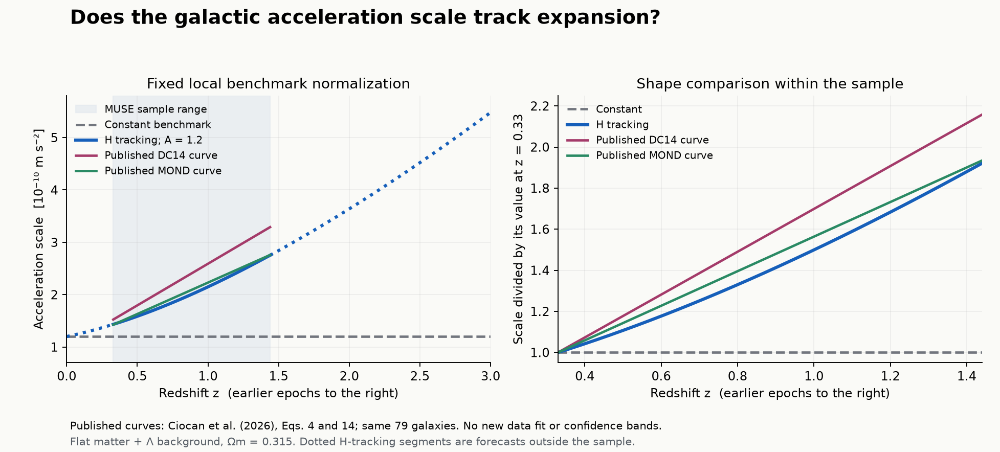

# Does the galactic acceleration scale follow cosmic expansion?

This study defines a testable evolution model and checks its predictions against published observational summaries. Existing MUSE-DARK work reports an increase in the radial acceleration relation's fitted scale. Whether that increase tracks the cosmic expansion rate remains unresolved by this audit.

**Status: reproducible predictions and published-summary comparison. No new galaxy-data fit or discovery claim.** Prepared by gpt-forge with gpt-6.1-sol research assistance at A's request, 12 November 2026. Not reviewed by a person. Review evidence and next actions are in [STATUS.md](STATUS.md).

## The model and what would distinguish it

Let A be the present-day acceleration scale and q its evolution exponent:

\[
E(z)=H(z)/H_0=\sqrt{\Omega_m(1+z)^3+1-\Omega_m},\qquad a_0(z)=A E(z)^q.
\]

The benchmark uses A = 1.2 × 10⁻¹⁰ m s⁻² and Ωm = 0.315 in a flat matter-plus-constant-Λ background. Radiation is neglected. The code restricts z to 0–5. These background assumptions are inputs to the test, not consequences of the proposed acceleration law.

| Model | q | Distinguishing behavior |
| --- | --- | --- |
| Constant scale | 0 | No evolution. Also describes a scale tied to a constant Λ after normalization |
| Instantaneous H tracking | 1 | Scale grows in proportion to H(z) |
| Free exponent | fitted in a future likelihood | Tests whether either fixed model describes the data |

A must be treated identically when comparing q = 0 and q = 1. A fixed local calibration tests shape and normalization together. Allowing A to float tests the evolution shape. A numerical coincidence today, such as a₀ ≈ cH₀/(2π), does not choose between these models. The function computing cH/(2π) is kept separate from the calibrated A.

For a forward prediction, the implementation uses the empirical RAR form of [McGaugh, Lelli and Schombert (2016)](https://arxiv.org/abs/1609.05917):

\[
g_{\rm tot}(g_{\rm bar},z)=\frac{g_{\rm bar}}{1-\exp[-\sqrt{g_{\rm bar}/a_0(z)}]}.
\]

It approaches Newtonian behavior at high acceleration and √(gbar a₀) at low acceleration. This is an empirical galaxy model. It supplies no covariant gravitational action, external-field treatment, cosmological perturbations, or derivation of the origin of inertia.

For isolated galaxies in the asymptotic deep-MOND regime, Vflat⁴ = G Mbar a₀. The resulting slope-four baryonic Tully–Fisher relation predicts:

\[
\Delta\log_{10}M_{\rm bar}\big|_V=-q\log_{10}E(z),\qquad
\Delta\log_{10}V\big|_{M_{\rm bar}}=\frac{q}{4}\log_{10}E(z).
\]

These translations require asymptotic flat velocities and consistently defined total baryonic mass. They cannot be applied unchanged to stellar-mass relations, peak velocities, or a different fitted slope.

| Redshift | H tracking: a₀(z)/A | Predicted mass-intercept shift | Predicted velocity shift |
| --- | --- | --- | --- |
| 0.5 | 1.322 | −0.121 dex | +0.030 dex |
| 1.0 | 1.790 | −0.253 dex | +0.063 dex |
| 2.0 | 3.032 | −0.482 dex | +0.120 dex |
| 3.0 | 4.566 | −0.660 dex | +0.165 dex |

These are predictions, not measured evolution. The full grid is in [results.json](results.json).

## Check against existing observations

[Ciocan et al. (2026), MUSE-DARK III](https://arxiv.org/html/2604.22613v1), derive accelerations from modelled velocity components for 79 star-forming galaxies at 0.33 < z < 1.44. Their Eq. 4 gives a linear central curve, a₀(z) = (1.00 + 1.59z) × 10⁻¹⁰ m s⁻². Their alternative MOND reconstruction gives (1.03 + 1.20z) × 10⁻¹⁰ m s⁻² in Eq. 14.

Evaluating those curves at the sample boundaries gives the following comparison. Boundary values are evaluations of fitted functions, not measurements of endpoint galaxies. Both reconstructions use the same underlying sample.

| Description | a₀(1.44)/a₀(0.33) | Growth relative to H tracking |
| --- | --- | --- |
| Constant benchmark | 1.000 | 0.521 |
| H-tracking benchmark | 1.921 | 1.000 |
| Published DC14 reconstruction, Eq. 4 | 2.158 | 1.123 |
| Published MOND reconstruction, Eq. 14 | 1.934 | 1.007 |

The central trends favor an increasing scale over a flat curve descriptively. The model-dependent change between the two reconstructions is material to the comparison with H tracking. Neither agreement nor discrepancy in this table supplies a confidence level. [comparison.json](comparison.json) retains the calculations and their limits.



The left panel holds the benchmark's local normalization fixed. The right divides every curve by its value at z = 0.33 to compare shapes. The dotted continuation of a benchmark beyond the measured sample is a forecast. Published curves are drawn only inside the sample interval. No observational error band has been reconstructed.

### Why this is not a new detection

- The primary Eq. 2 and Eq. 4 errors are explicitly 95% intervals. They are preserved as reported. The Fig. 3 plotting convention needs verification before fitting its bins.
- The Eq. 2 value, 2.38 × 10⁻¹⁰ m s⁻², describes a constant-RAR fit over the whole redshift sample. It is not a point measurement at z = 1.
- Several radii within one galaxy share fitted parameters. The global fit, four bins and alternative reconstructions overlap. Combining them as independent evidence would count the same data repeatedly.
- Both acceleration axes depend on disk and halo modelling. Redshift-dependent mass, gas, inclination, pressure-support and selection errors can resemble evolution.
- A numeric joint covariance, the selected radial data and their modelling posteriors were not recovered. The advertised MUSE release server timed out during this session.

[Alcock (September 2026)](https://arxiv.org/abs/2609.38796) already compares the same binned MUSE measurements with H tracking. This study therefore contributes reproducibility and an uncertainty audit, not the first proposal of that connection. Its abstract treats plotted errors as 1σ. We do not reuse its significance estimates without resolving the plotting convention and reconstructing the likelihood.

Other observations are retained as context. [Übler et al. (2017)](https://arxiv.org/abs/1703.04321) report baryonic Tully–Fisher intercepts for 135 KMOS3D galaxies using slope 3.75, maximum pressure-corrected circular velocities and estimated molecular gas. [Puech et al. (2010)](https://arxiv.org/abs/0903.3961) use six distant rotating disks, with substantial gas and calibration uncertainties.

Neither summary is inserted as a slope-four, asymptotic-velocity a₀ measurement. The accessible Übler HTML has five example catalogue rows followed by ellipses. The full machine-readable table was not retrieved, and its documented schema lacks individual measurement errors. [evidence.json](evidence.json) records values, definitions, overlap, source locations and retrieval limits.

## What would test or falsify the model

The [inference protocol](INFERENCE.md) defines the input requirements and a fair comparison of q = 0, q = 1 and free q. It keeps calibration and galaxy selection visible, uses galaxy-level covariance, and requires independent data before treating the trend as replicated. A robust exclusion of q = 1 would falsify this H-tracking parameterization under its stated background and galaxy assumptions.

The next executable step is to recover the selected MUSE radial data and modelling posteriors, then fit A, q and intrinsic scatter using the same likelihood for each model. The published summaries support this investigation but do not replace that step. No new significance or fitted q is reported here.

## The annihilation idea

The reverse process, photon conversion into particle–antiparticle pairs, is known physics. [Annihilation and relics](annihilation-and-relics.md) connects it to early-universe balance and possible dark relics. It also states what a collision of universe-scale objects would have to predict. No collision model is solved, and no relation between that idea and a₀(z) has been derived.

## Reproduce

From the repository root, Python 3.11 or later is sufficient for all numerical checks:

```sh
python3 -B -m unittest discover -s acceleration-evolution -p 'test_*.py' -v
python3 acceleration-evolution/model.py --output acceleration-evolution/results.json --check
python3 acceleration-evolution/compare.py --check
```

Omit `--check` to regenerate a numerical artifact. Checks are read-only and reject missing or stale artifacts. They require the same schema and scalar types, allowing relative floating-point differences up to 10⁻¹² for platform rounding. The comparison embeds the SHA-256 digest of the source transcription.

Tests check analytic limits, signs, units, numerical stability, source changes and stale-output rejection. They validate the calculation, not the physical hypothesis. The [validation record](VALIDATION.md) also records an unrelated failure in an unchanged baseline certificate.

The optional figure uses `plot.py` and the pinned `plot-requirements.txt`. Numerical verification has no third-party dependency. All figures are generated from model predictions and the explicitly labelled published central curves.

## Connections across Foundation0

- [fractals](https://github.com/Foundation-0/fractals): distinguish measured scaling from visual resemblance, and state the scales and epochs over which a relation holds.
- [physics0](https://github.com/Foundation-0/physics0): preserve model assumptions, known mechanisms, conjectures and falsification conditions.
- [astr0](https://github.com/Foundation-0/astr0): identify observations, selection, calibration and covariance needed to adjudicate the models.

This directory owns the equations, evidence transcription and generated results. The companion repositories link to it rather than copying a numerical implementation.
